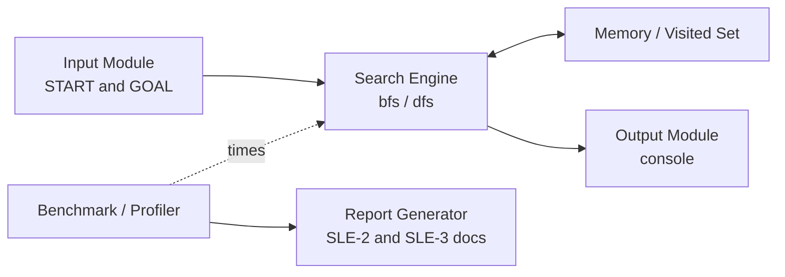
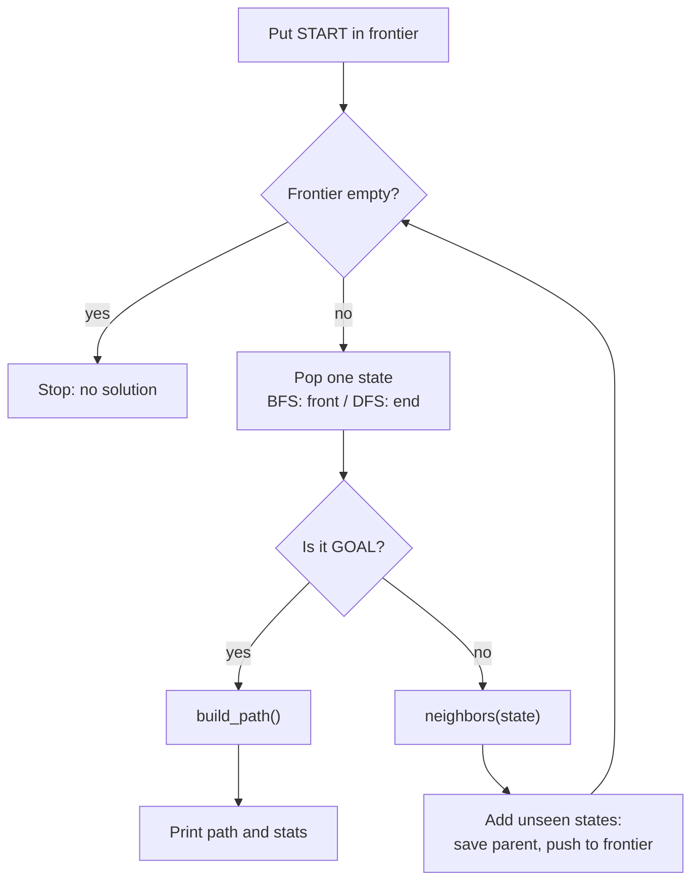

# SLE-3: Architectural Design (Full C4 Model)

**Course:** 02AML204 – Introduction to Artificial Intelligence
**Author:** Aayaan Dheeraj Kalawant · PRN 25UAM016
**Class:** S.Y. CSE (AIML), Division A · DKTE Ichalkaranji
**Date:** 29 September 2026
**Deliverable:** `SLE3_25UAM016.docx`

---

## 1. What this is

A C4 architecture model of the **8-Puzzle BFS vs DFS Search System**, a Python console program that solves the 3×3 sliding-tile puzzle with two uninformed search strategies (Breadth-First Search and Depth-First Search) and compares them on:

- execution time
- number of states expanded
- whether the returned solution is the shortest possible

It continues from **SLE-1** (the search code) and **SLE-2** (the profiling and comparison report on the same system).

## 2. Why C4?

C4 describes one system at four zoom levels, so a reader can understand the design without reading the code. Here it also shows *where* the BFS vs DFS difference lives: inside the Search Engine, in the Frontier component.

| Level | Diagram | What it shows |
|---|---|---|
| 1 | Context | The system as one box between the Student/User and the Console, plus the SLE-2 report it feeds |
| 2 | Container | The 6 main modules inside the system |
| 3 | Component | The internal parts of the Search Engine |
| 4 | Code | The actual functions |

## 3. Level 2: Containers

| Container | Responsibility |
|---|---|
| Input Module | Holds the fixed START and GOAL board states |
| Search Engine | Runs `bfs()` and `dfs()` |
| Memory / Visited Set | Parent dictionary and frontier (deque for BFS, list-as-stack for DFS) |
| Output Module | `print_state()` and the final comparison summary |
| Benchmark / Profiler | `run_benchmark()` times each algorithm over 3 runs with `perf_counter()`; `cProfile` shows time per function |
| Report Generator | Turns the measured numbers into the SLE-2 and SLE-3 documents |

## 4. Level 3: Search Engine components

| Component | Role |
|---|---|
| Frontier / Open List | States waiting to be expanded. Deque (FIFO) for BFS, list used as a stack (LIFO) for DFS |
| Neighbor Generator `neighbors()` | Produces every valid board reached by sliding a tile into the blank |
| Explored / Visited Set | The parent dictionary: prevents revisiting states and lets the path be rebuilt |
| Goal Test | Compares each popped state with GOAL |
| Path Reconstructor `build_path()` | Walks parent pointers from GOAL back to START |

The only difference between BFS and DFS is the "Pop one state" step. Everything else is shared.

## 5. Level 4: Code overview

- **No classes.** States are plain tuples of 9 ints, so they are hashable and can be dictionary keys.
- `neighbors(state)`: returns every board reachable by one blank-tile move.
- `bfs(start)`: FIFO search; guarantees the shortest solution.
- `dfs(start)`: LIFO search; finds a solution but not necessarily the shortest.
- `build_path(parent)`: rebuilds the move sequence from GOAL back to START.
- `run_benchmark(name, function)`: runs an algorithm 3 times and averages the timing.

## 6. Key design decisions

1. **Immutable tuples instead of lists** so states can be dictionary keys, giving O(1) visited checks.
2. **One shared `neighbors()` function** for both algorithms, so any performance gap comes from the search strategy (queue vs stack) and not from different move-generation code.
3. **DFS reverses neighbor order before pushing**, so both algorithms try moves in the same priority and the frontier structure is the one real difference being measured.

## 7. How to use this document

1. Read Level 1 to see what the system does and who uses it.
2. Read Level 2 to see the modules and how data flows between them.
3. Read Level 3 to see where the BFS vs DFS difference actually sits.
4. Read Level 4 to map each box to a real function.

## 8. AI contribution

- **Tools:** ChatGPT (SLE-1/2 code and report), Claude (SLE-3 C4 diagrams and report).
- **AI helped with:** drawing the four C4 levels from the existing code, structuring containers and components, drafting explanations.
- **I did myself:** chose the 8-puzzle system to carry forward, checked every diagram against my code, and reviewed the design decisions so I can explain them.

## 9. Related files

- SLE-1: working solver (`neighbors`, `bfs`, `dfs`, `build_path`)
- SLE-2: profiling and comparison report
- SLE-4: Architecture Decision Record (see `README_SLE4.md`)
